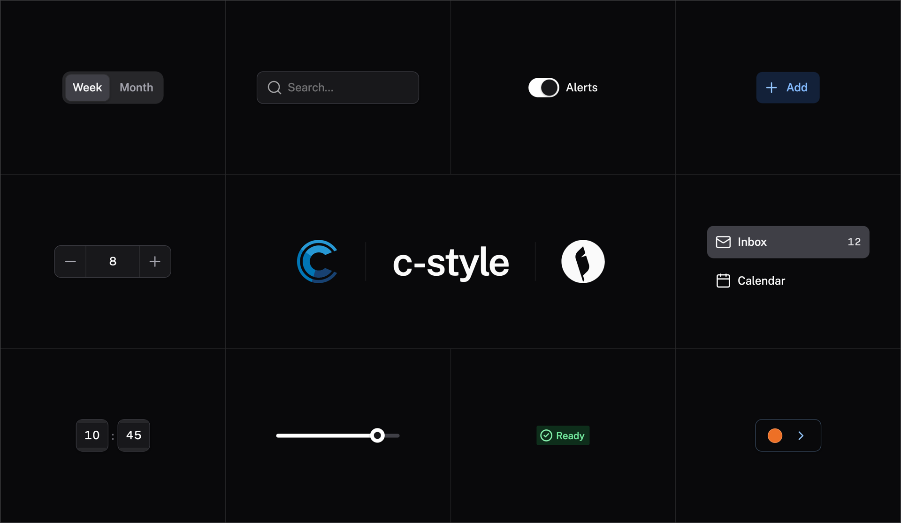

# coalesce-c-style

[Canon](https://recepkutuk.github.io/canon/reference/introduction.html)'s look for Vuetify 4 and [IntelliTect Coalesce](https://intellitect.github.io/Coalesce/), without rewriting your templates.

Keep using `<v-btn>`, `<v-text-field>` and `<c-admin-table-page>`. c-style gives them tighter controls, neutral navigation, Lucide icons, quieter alerts and consistent spacing. Configure your brand once and it applies across the app.

The C stands for **Coalesce**, **Canon**, and for what goes away: the **chunkiness**. Same `<v-btn>`, same `<c-admin-table-page>`; tighter controls, simpler color, no Material slabs.

## Why Canon x Coalesce?

[Coalesce](https://intellitect.github.io/Coalesce/) is for building fast, enterprise-ready apps. It shines for powerful internal tools. It isn't about making something pretty; it's about making something reliable and good.

Canon shares that philosophy: **simple and reliable**. It isn't a convoluted CSS styling library. It is a small set of basic components with plain markup, so everything stays aligned by default and there is little to get wrong.

That simplicity is what makes **rebranding easy**, which is the point:

- **One place decides the look.** A rebrand, a client's colors or a new design system is a new theme, and the pages stay as they are.
- **Basic components, consistent everywhere.** The same elements get the same look on every screen, so a change lands everywhere at once.
- **A current look that lasts.** You get a modern, polished interface in your own brand colors, without a front-end team and without a framework that needs constant upkeep.

Together you get c-style: Coalesce, ready for stakeholders who expect a 2026 look, and an app by Friday.

## What you get

- **Light and dark themes**, following the OS by default.
- **Brand colors** from a hex value or a Tailwind palette name, with runtime switching.
- **Public Sans bundled locally**, with optional Inter or your own font.
- **Coalesce admin styling** for tables, editors and audit pages.
- **Time inputs** for keyboard-friendly time and time-range entry.
- **Tokens and SCSS mixins** for styling your own components to match.

c-style uses Vuetify's themes, component defaults and Sass settings, so you can keep using Vuetify's configuration and component props. See the [usage reference](packages/c-style/README.md) for the full API and [known differences from Canon](packages/c-style/docs/canon-differences.md).

## Before and after

Stock Coalesce starter template (Vuetify 4 + Material) on the left, the same app with c-style on the right. Same view, same code, dark mode, 1440×900.

| Before                                                             | After                                                               |
| ------------------------------------------------------------------ | ------------------------------------------------------------------- |
|  |  |

## What's chunky about stock Vuetify

Vuetify's defaults are Material Design 2 at full volume. Common pain points include:

- **The primary colour is the nav bar.** A slab of saturated brand colour across the top of every page, so the chrome competes with the content.
- **FontAwesome Solid icons.** Heavy, filled and near-black; they outweigh the text beside them.
- **Tabs that float in space.** An underline and nothing else, with no container to say what the tabs belong to.
- **Buttons with drastic elevation.** Drop shadows and Material 2 ripple animations on every click.
- **Alerts that shout.** The alert level sets the whole background, so a page with four messages looks like a traffic light.
- **Harsh shadows on every card.** Elevation stands in for borders.
- **A dropdown caret that doesn't match its field.** A solid triangle on a hairline outline: the heaviest mark in the control.

c-style replaces each one with Canon's quieter equivalent: a neutral nav bar, 1.5px Lucide icons, tabs in a segmented container, flat tonal buttons, alerts with a status edge and an icon, hairline-and-shadow cards and a thin chevron.

The collage below shows these differences on one canvas. Light and dark, stock then c-style:

| Before                                                              | After                                                                |
| ------------------------------------------------------------------- | -------------------------------------------------------------------- |
|  |  |
|    |    |

## Use it in your app

Choose a c-style release matching your app's Coalesce release:

```sh
# Replace <matching-version> with the selected release.
pnpm add --save-exact "coalesce-c-style@<matching-version>"
```

The [package manifest](packages/c-style/package.json) defines supported peer dependency ranges. See [Install](packages/c-style/README.md#install) for choosing and configuring a release.

Replace the Vuetify plugin in `vite.config.ts`:

```diff
-import createVuetify, { transformAssetUrls } from "vite-plugin-vuetify";
+import { transformAssetUrls } from "vite-plugin-vuetify";
+import { cStyle } from "coalesce-c-style/vite";
 ...
-    createVuetify({ autoImport: true }),
+    cStyle(),
```

Keep `createVuePlugin({ template: { transformAssetUrls } })` and the other Vite plugins. `cStyle()` includes `vite-plugin-vuetify` with auto-import enabled; use it only once and pass any existing Vuetify plugin options through `cStyle({ vuetify: { /* options */ } })`. For custom Sass settings, see [Overriding Sass settings](packages/c-style/docs/configuration.md#overriding-sass-settings).

In `main.ts`, import c-style after Coalesce and Vuetify styles, and before your app's styles:

```ts
import "coalesce-vue-vuetify3/styles.css";
import "vuetify/styles";
import "coalesce-c-style/styles";
import "@/styles/site.scss";

import { createVuetify } from "vuetify";
import { cStyleBlueprint } from "coalesce-c-style";

const vuetify = createVuetify({
  blueprint: cStyleBlueprint({ colors: { primary: "#2563eb" } }),
});
```

Replace the starter's Font Awesome icon configuration, input defaults and empty light/dark theme configuration with the blueprint above. Remove Roboto imports if you use the bundled Public Sans. Keep any other app-specific Vuetify options.

Options beside `blueprint` override its defaults, so review retained `icons`, `defaults` and `theme` settings. Keep the existing `app.use(vuetify)` and Coalesce registration. Supported Font Awesome and Roboto package CSS imports are excluded by `cStyle()` by default; CDN links, copied vendor stylesheets and Sass entry points remain active. See [exclusion scope and opt-ins](packages/c-style/docs/configuration.md#excluding-replaced-font-styles), including how to retain styles for unmapped Font Awesome icons or Roboto.

Follow the [starter app migration steps](packages/c-style/README.md#adopting-it-in-a-coalesce-app) to remove conflicting `site.scss` rules and check CSS import order. Keep your routes and component structure, but audit existing Material color helpers and named color props using the [semantic color migration guidance](packages/c-style/docs/configuration.md#semantic-colors). For a gradual migration, custom Sass settings can restore `$color-pack: true`.

## Versions and compatibility

Choose a c-style release matching your app's Coalesce version. Versions follow `<Coalesce version>-cs.<build>`; the build suffix identifies c-style updates for that Coalesce release. Pin the chosen version explicitly because these releases use prerelease versions.

The [package manifest](packages/c-style/package.json) defines the package version, supported peer ranges and dependencies used by its test environment. Read the manifest from the release you are adopting; repository `main` can be ahead of the published package.

## Tweak the look

Set colors in the blueprint:

```ts
cStyleBlueprint({
  colors: {
    primary: "#7c3aed",
    neutral: "slate",
    success: "emerald",
    dark: { primary: "#a78bfa" },
  },
});
```

Public Sans is the default. To replace it for body text and headings:

```ts
// vite.config.ts
cStyle({ font: "Inter" });

// main.ts
import "coalesce-c-style/styles";
import "coalesce-c-style/fonts/inter";
```

For your own font, use its family name and import its stylesheet. A custom default omits the automatic Public Sans bundle; additional font imports still work.

Use the standard Vuetify props for individual components:

```vue
<v-btn color="primary" variant="flat">Save</v-btn>
<v-btn color="neutral" variant="outlined" size="small">Cancel</v-btn>
```

Use semantic colors such as `primary`, `neutral`, `success` and `error` so components follow the active brand and theme. Literal Material palette helpers such as `text-grey` and `bg-blue-lighten-2` are disabled by default; see [Semantic colors](packages/c-style/docs/configuration.md#semantic-colors) for replacements and the compatibility option.

For more control:

- [Colors](packages/c-style/docs/configuration.md#colours) and [fonts](packages/c-style/docs/configuration.md#font), including runtime switching.
- [Sizes](packages/c-style/docs/components.md#sizes) and [Sass settings](packages/c-style/docs/configuration.md#overriding-sass-settings) for dimensions and spacing.
- [Icons](packages/c-style/docs/components.md#icons) and [time inputs](packages/c-style/docs/components.md#components-canon-time).
- [Styling your own components](packages/c-style/docs/styling.md) with tokens and SCSS mixins.
- [Troubleshooting](packages/c-style/README.md#troubleshooting) for setup issues.

## Developing c-style

See the [development README](DEVELOPMENT.md) for repository setup, the demo app, Storybook, tests, implementation notes and releases.

## Credits

**[Canon](https://recepkutuk.github.io/canon/) by Recep Kütük** ([repository](https://github.com/recepkutuk/canon), MIT) is the design. c-style reproduces Canon's design decisions (measurements, tones, colour roles, motion and component behaviours) for Vuetify and Coalesce, and ports some of its component recipes. c-style is independent and isn't affiliated with or endorsed by the Canon project. Canon's license and the other notices are in [packages/c-style/THIRD-PARTY-NOTICES.md](packages/c-style/THIRD-PARTY-NOTICES.md).

c-style is built on, and bundles or depends on:

- [Vuetify](https://vuetifyjs.com) (MIT)
- [IntelliTect Coalesce](https://github.com/IntelliTect/Coalesce) (Apache 2.0)
- [Lucide](https://lucide.dev) icons (ISC)
- [Public Sans](https://public-sans.digital.gov) (SIL Open Font License 1.1), the default font
- [Inter](https://rsms.me/inter/) by Rasmus Andersson (SIL Open Font License 1.1), Canon's font, opt-in
- The [Tailwind CSS](https://tailwindcss.com) v3 colour palette (MIT)
