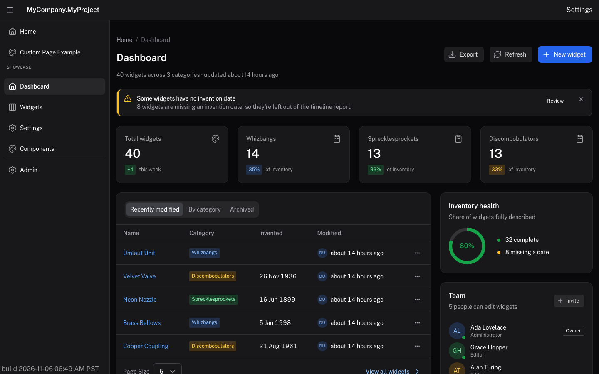
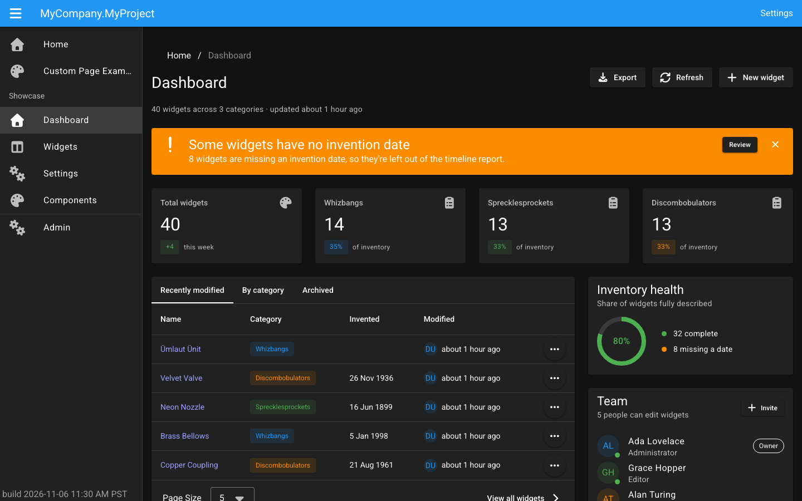
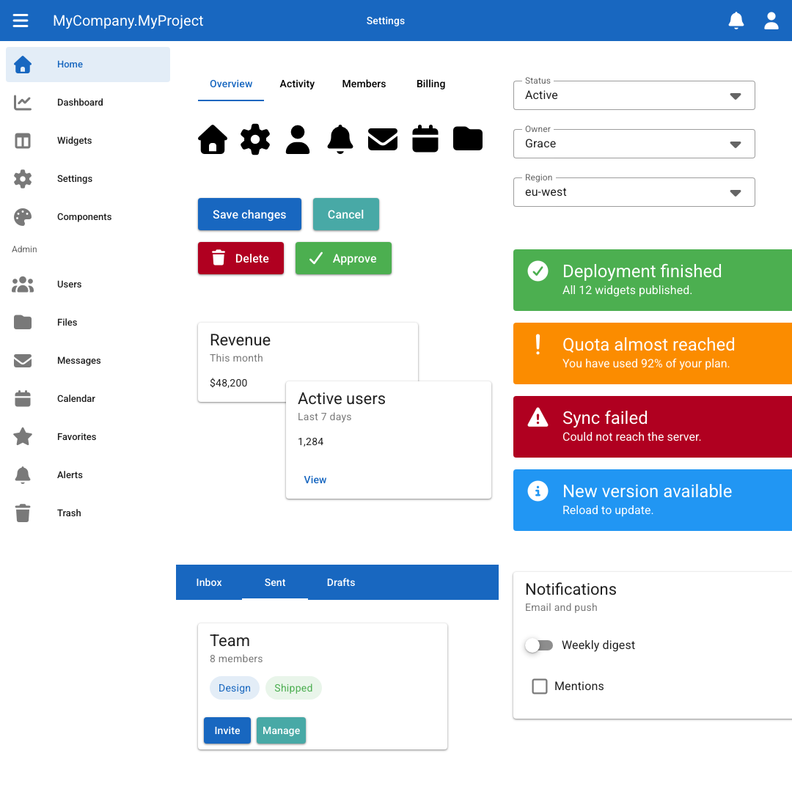
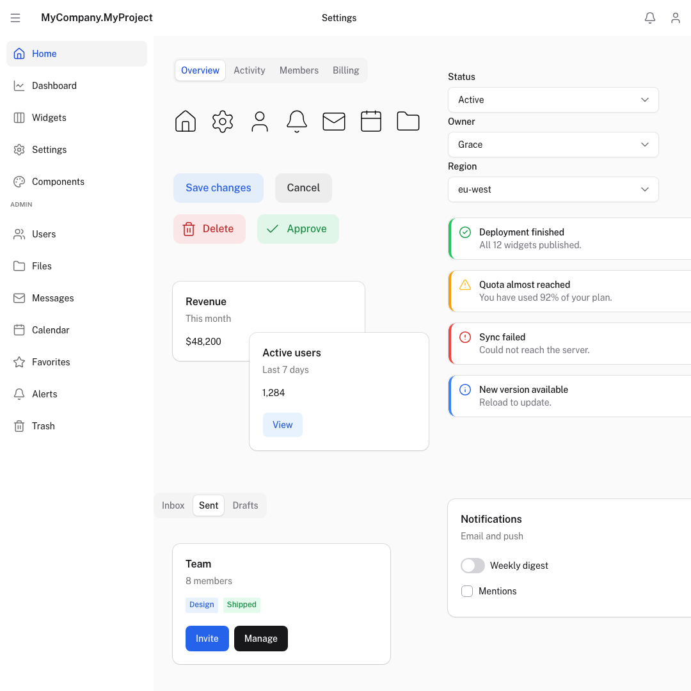
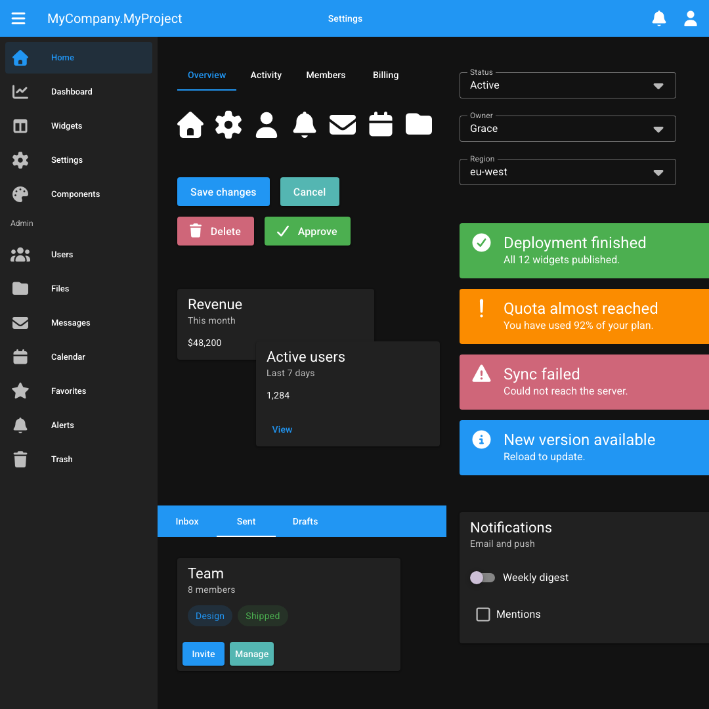
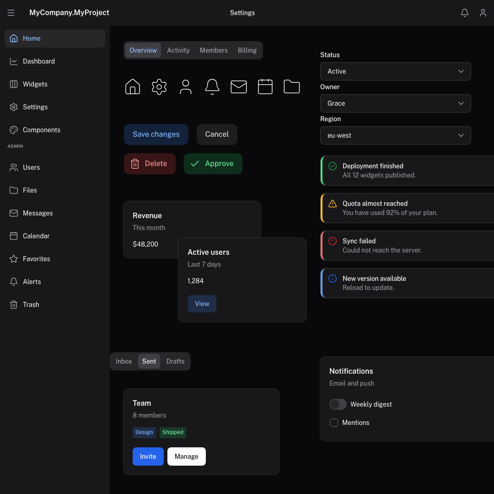

# coalesce-c-style

[Canon](https://recepkutuk.github.io/canon/reference/introduction.html)'s look for Vuetify 4 and [IntelliTect Coalesce](https://intellitect.github.io/Coalesce/), without rewriting your templates.

Keep using `<v-btn>`, `<v-text-field>` and `<c-admin-table-page>`. c-style gives them tighter controls, neutral navigation, Lucide icons, quieter alerts and consistent spacing. Configure your brand once and it applies across the app.

The C stands for **Coalesce**, **Canon**, and for what goes away: the **chunkiness**. Same `<v-btn>`, same `<c-admin-table-page>`; tighter controls, simpler color, no Material slabs.



## Why Canon x Coalesce?

[Coalesce](https://intellitect.github.io/Coalesce/) is for building fast, enterprise-ready apps. It shines for powerful internal tools. It isn't about making something pretty; it's about making something reliable and good.

Canon shares that philosophy: **simple and reliable**. It isn't a convoluted CSS styling library. It is a small set of basic components with plain markup, so everything stays aligned by default and there is little to get wrong.

That simplicity is what makes **rebranding easy**, which is the point:

- **One place decides the look.** A rebrand, a client's colors or a new design system is a new theme, and the pages stay as they are.
- **Basic components, consistent everywhere.** The same elements get the same look on every screen, so a change lands everywhere at once.
- **A current look that lasts.** You get a modern, polished interface in your own brand colors, without a front-end team and without a framework that needs constant upkeep.

Together you get c-style: Coalesce, ready for stakeholders who expect a 2026 look, and an app by Friday.

## What you get

- **Light and dark themes**, following the OS by default.
- **Brand colors** from a hex value or a Tailwind palette name, with runtime switching.
- **Public Sans bundled locally**, with optional Inter or your own font.
- **Coalesce admin styling** for tables, editors and audit pages.
- **Time inputs** for keyboard-friendly time and time-range entry.
- **Tokens and SCSS mixins** for styling your own components to match.

c-style uses Vuetify's themes, component defaults and Sass settings, so you can keep using Vuetify's configuration and component props. See the [usage reference](packages/c-style/README.md) for the full API and [known differences from Canon](packages/c-style/README.md#known-deviations-from-canon).

## Before and after

Stock Coalesce starter template (Vuetify 4 + Material) on the left, the same app with c-style on the right. Same view, same code, dark mode, 1440×900.

| Before | After |
|---|---|
|  |  |

## What's chunky about stock Vuetify

Vuetify's defaults are Material Design 2 at full volume. Seven things stand out:

- **The primary colour is the nav bar.** A slab of saturated brand colour across the top of every page, so the chrome competes with the content.
- **FontAwesome Solid icons.** Heavy, filled and near-black; they outweigh the text beside them.
- **Tabs that float in space.** An underline and nothing else, with no container to say what the tabs belong to.
- **Buttons with drastic elevation.** Drop shadows and Material 2 ripple animations on every click.
- **Alerts that shout.** The alert level sets the whole background, so a page with four messages looks like a traffic light.
- **Harsh shadows on every card.** Elevation stands in for borders.
- **A dropdown caret that doesn't match its field.** A solid triangle on a hairline outline: the heaviest mark in the control.

c-style replaces each one with Canon's quieter equivalent: a neutral nav bar, 1.5px Lucide icons, tabs in a segmented container, flat tonal buttons, alerts with a status edge and an icon, hairline-and-shadow cards and a thin chevron.

The collage below puts all seven on one canvas. Light and dark, stock then c-style:

| Before | After |
|---|---|
|  |  |
|  |  |

## Use it in your app

For an app on Coalesce 6.5.1:

```sh
pnpm add --save-exact coalesce-c-style@6.5.1-cs.2
```

Your app also needs Vue 3.5+, Vuetify 4.3, Vite 7 or 8, `vite-plugin-vuetify` 2.1 and Sass 1.80+. See [Install](packages/c-style/README.md#install) for the peer dependency ranges.

Replace the Vuetify plugin in `vite.config.ts`:

```diff
-import createVuetify, { transformAssetUrls } from "vite-plugin-vuetify";
+import { transformAssetUrls } from "vite-plugin-vuetify";
+import { cStyle } from "coalesce-c-style/vite";
 ...
-    createVuetify({ autoImport: true }),
+    cStyle(),
```

In `main.ts`, import c-style after Coalesce and Vuetify styles, and before your app's styles:

```ts
import "coalesce-vue-vuetify3/styles.css";
import "vuetify/styles";
import "coalesce-c-style/styles";
import "@/styles/site.scss";

import { createVuetify } from "vuetify";
import { cStyleBlueprint } from "coalesce-c-style";

const vuetify = createVuetify({
  blueprint: cStyleBlueprint({ colors: { primary: "#2563eb" } }),
});
```

Replace the starter's Font Awesome icon configuration, input defaults and empty light/dark theme configuration with the blueprint above. Remove Roboto imports if you use the bundled Public Sans. Keep any other app-specific Vuetify options.

Follow the [starter app migration steps](packages/c-style/README.md#adopting-it-in-a-coalesce-app) to remove conflicting `site.scss` rules and check CSS import order. Your routes, views and Coalesce props stay as they are.

## Versions and compatibility

Choose the c-style version that matches your app's Coalesce version. Versions follow **`<Coalesce version>-cs.<build>`**: `6.5.1-cs.1` is c-style build 1 for Coalesce 6.5.1.

The Coalesce part identifies the release c-style is tested with and works best with. The `cs` build number increases for c-style updates to that release and starts again at 1 for a new Coalesce version. Other Coalesce versions may work, but are not the tested match.

| c-style | Tested Coalesce (`coalesce-vue-vuetify3`) | Tested Vuetify |
|---|---|---|
| `6.5.1-cs.2` | `6.5.1` | `4.3.2` |
| `6.5.1-cs.1` | `6.5.1` | `4.3.2` |

The Vuetify peer range is `^4.3.0`. npm treats `-cs.*` versions as prereleases, so a range such as `^6.5.1` does not select them. Pin a matching build explicitly; the unversioned install command selects the latest published build, which may target a different Coalesce release.

## Tweak the look

Set colors and font in one place:

```ts
cStyleBlueprint({
  colors: {
    primary: "#7c3aed",
    neutral: "slate",
    success: "emerald",
    dark: { primary: "#a78bfa" },
  },
  font: "Public Sans",
});
```

Public Sans is included. To use Canon's Inter, import `"coalesce-c-style/fonts/inter"` after c-style's styles and set `font: "Inter"`. For another font, ship its font files in your app and set its family name.

Use the standard Vuetify props for individual components:

```vue
<v-btn color="primary" variant="flat">Save</v-btn>
<v-btn color="neutral" variant="outlined" size="small">Cancel</v-btn>
```

Use semantic colors such as `primary`, `neutral`, `success` and `error` so components follow the active brand and theme. Literal Material palette helpers such as `text-grey` and `bg-blue-lighten-2` are disabled by default; see [Semantic colors](packages/c-style/README.md#semantic-colors) for replacements and the compatibility option.

For more control:

- [Colors](packages/c-style/README.md#colours) and [fonts](packages/c-style/README.md#font), including runtime switching.
- [Sizes](packages/c-style/README.md#sizes) and [Sass settings](packages/c-style/README.md#overriding-sass-settings) for dimensions and spacing.
- [Icons](packages/c-style/README.md#icons) and [time inputs](packages/c-style/README.md#components-canon-time).
- [Styling your own components](packages/c-style/README.md#styling-your-own-components) with tokens and SCSS mixins.
- [Troubleshooting](packages/c-style/README.md#troubleshooting) for setup issues.

## Developing c-style

See the [development README](DEVELOPMENT.md) for repository setup, the demo app, Storybook, tests, implementation notes and releases.

## Credits

**[Canon](https://recepkutuk.github.io/canon/) by Recep Kütük** ([repository](https://github.com/recepkutuk/canon), MIT) is the design. c-style reproduces Canon's design decisions (measurements, tones, colour roles, motion and component behaviours) for Vuetify and Coalesce, and ports some of its component recipes. c-style is independent and isn't affiliated with or endorsed by the Canon project. Canon's license and the other notices are in [packages/c-style/THIRD-PARTY-NOTICES.md](packages/c-style/THIRD-PARTY-NOTICES.md).

c-style is built on, and bundles or depends on:

- [Vuetify](https://vuetifyjs.com) (MIT)
- [IntelliTect Coalesce](https://github.com/IntelliTect/Coalesce) (Apache 2.0)
- [Lucide](https://lucide.dev) icons (ISC)
- [Public Sans](https://public-sans.digital.gov) (SIL Open Font License 1.1), the default font
- [Inter](https://rsms.me/inter/) by Rasmus Andersson (SIL Open Font License 1.1), Canon's font, opt-in
- The [Tailwind CSS](https://tailwindcss.com) v3 colour palette (MIT)
